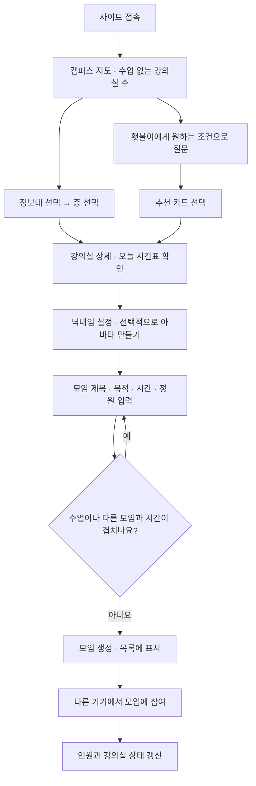
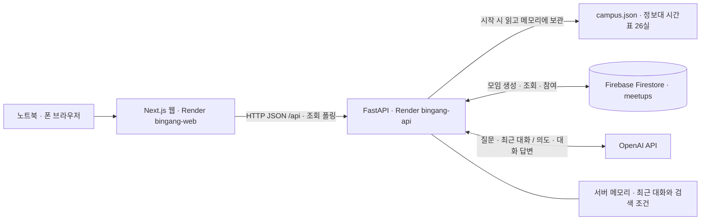
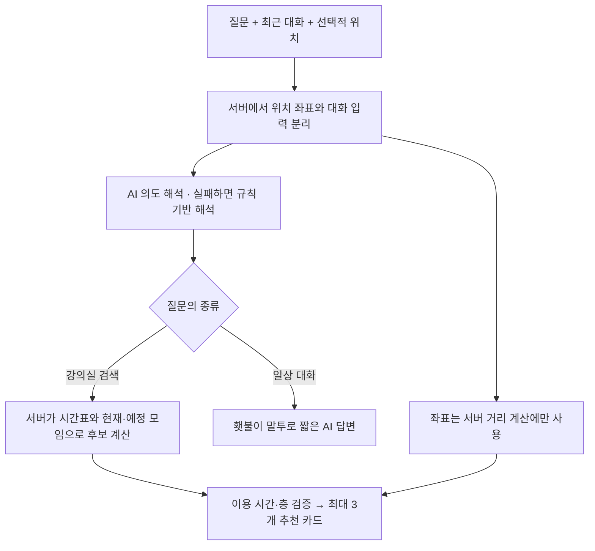

# 빈강 — 빈 강의실에서 시작하는 대학 생활

**서비스 바로가기: [https://bingang-web.onrender.com/](https://bingang-web.onrender.com/)**

> 시간표로 빈 강의실을 찾고, 공부할 사람을 모으고, 횃불이에게 자연어로 장소를 추천받는 캠퍼스 웹 서비스입니다.

인천대학교 「AI로 다시 쓰는 대학 생활」 바이브코딩 대회에서 3명이 개발했습니다. **현재 구현 범위는 정보대(7호관) 1–5층, 시간표가 있는 강의실 26개**입니다. 이 문서는 2026-11-07 기준 통합 코드의 사용법과 구조를 설명합니다.

[시연 시작](https://bingang-web.onrender.com/?at=2026-11-10T14%3A10%3A00%2B09%3A00) · [API 문서](https://bingang-api.onrender.com/docs) · [프롬프트 기록](docs/prompts/) · [개발 기록](docs/log/)

## 목차

- [어떤 서비스인가요?](#어떤-서비스인가요)
- [사용 흐름](#사용-흐름)
- [직접 시연하기](#직접-시연하기)
- [시스템 구성](#시스템-구성)
- [횃불이 AI가 답하는 과정](#횃불이-ai가-답하는-과정)
- [로컬에서 실행하기](#로컬에서-실행하기)
- [환경변수와 배포](#환경변수와-배포)
- [코드와 API 찾아보기](#코드와-api-찾아보기)
- [AI를 활용한 개발 과정](#ai를-활용한-개발-과정)
- [검증 상태와 현재 한계](#검증-상태와-현재-한계)
- [관련 문서와 출처](#관련-문서와-출처)

## 어떤 서비스인가요?

도서관 스터디룸이 부족하거나 다음 수업 전에 공부할 곳이 필요할 때, 강의실별 시간표를 하나씩 확인하는 수고를 줄입니다. 빈 공간을 찾는 데서 이어서 그 공간에 공부·프로젝트 모임을 만들고 다른 사람과 함께 이용할 수 있습니다.

| 기능 | 사용자가 할 수 있는 일 |
| --- | --- |
| 강의실 찾기 | 건물·층·최소 여유 시간으로 조회하고, 오늘 시간표와 다음 수업까지 남은 시간 확인 |
| 캠퍼스 시각화 | 3D 캠퍼스에서 정보대를 선택하고 층별 도면 → 강의실 상세로 이동 |
| 모임 | 제목·목적·시간·정원을 정해 생성하고 다른 기기에서 참여·나가기, 주최자는 취소 |
| 시간 슬라이더·아바타 | 모임 시간을 조절하고 닉네임과 조합형 프로필 얼굴 설정 |
| 횃불이 챗봇 | 오른쪽 아래 마스코트 옆 작은 대화창에서 장소 추천과 일상 대화 |
| 위치 추천 | 위치 권한을 허용하면 정보대까지의 예상 이동 시간 확인, 직접 말한 현재 층을 추천 순서에 반영 |

**모임은 강의실 사용 승인이나 독점 예약이 아닙니다.** 시간표상 수업이 없다는 뜻이며, 문이 열려 있는지와 실제 사용 가능 여부는 현장에서 확인해야 합니다.

## 사용 흐름



- **지도 `/`**: 정보대의 전체·층별 집계와 3D 지도. 다른 건물은 현재 조회 대상이 아닙니다.
- **층별 보기 `/buildings/eng`**: 층 선택, 강의실 도면과 상태, 최소 여유 시간 필터.
- **강의실 상세 `/rooms/{roomId}`**: 당일 시간표, 모임 목록, 모임 만들기.
- **모임 `/meetups`**: 모임 생성·참여·나가기·취소. 별도 모임원 간 채팅은 없습니다.
- **횃불이**: 화면 오른쪽 아래에서 열고 닫는 전역 대화창으로, 별도 페이지로 이동하지 않습니다.

| 상태 | 의미 |
| --- | --- |
| `empty` · 비어 있음 | 선택한 시각에 수업도 진행 중인 모임도 없음 |
| `class` · 수업 중 | 시간표에 수업이 잡혀 있음 |
| `meetup` · 모임 중 | 수업은 없고, 등록된 모임이 진행 중 |
| `closed` · 운영 종료 | 앱이 정한 조회 운영 시간인 09:00–22:00 밖 |

홈의 **“수업 없는 강의실” 수에는 모임 중인 방도 포함**됩니다. 이것은 실제 좌석 점유 센서로 측정한 빈자리 수가 아닙니다.

## 직접 시연하기

설치 없이 [시연 링크](https://bingang-web.onrender.com/?at=2026-11-10T14%3A10%3A00%2B09%3A00)를 열면 **2026-11-10(화) 14:10 KST** 기준으로 조회합니다. 무료 호스팅이 대기 중이면 첫 화면이 뜨기까지 시간이 걸릴 수 있습니다.

1. 노트북과 폰에서 같은 링크를 열고 각각 닉네임을 설정합니다. 같은 브라우저의 탭은 사용자 정보를 공유하므로 두 사용자 검증에는 다른 기기나 독립된 브라우저를 사용합니다.
2. **정보대 → 3층 → 302호**로 이동합니다. 시간표상 16:30까지 140분 수업이 없습니다.
3. 다른 모임이 없다면 **14:10–16:10 / 정원 4명**으로 모임을 만듭니다.
4. 두 번째 기기에서 **모임 → 참여하기**를 누릅니다. 주최자 화면도 인원이 **1/4 → 2/4**로 바뀌는지 확인합니다.
5. 횃불이에게 **“7호관에서 2시간 공부할 곳 찾아줘” → “그럼 3층은?”**이라고 이어서 질문합니다. **“공부하느라 피곤해”**처럼 일반 대화도 가능합니다.
6. 검증 후 주최자가 만든 모임을 취소하면 다른 방문자의 시연을 방해하지 않습니다.

직접 만든 변경은 즉시 재조회하고, 다른 사용자의 변경은 화면이 활성화된 상태에서 **약 5초 간격의 폴링**으로 반영합니다. WebSocket이나 Firestore 실시간 구독 방식은 아닙니다.

### 시간이 지나도 재현하려면

- `?at=`는 **조회 기준 시각**입니다. ISO 8601 형식이고 URL의 `+09:00`은 `%2B09:00`으로 인코딩합니다.
- 기준 시각은 브라우저에 저장됩니다. 실제 현재 시각으로 돌아가려면 헤더의 **“시연 시각 해제”**를 누릅니다.
- 모임 **참여 가능 여부는 서버의 실제 현재 시각**으로 판단합니다. 위 시연 날짜가 지난 뒤에는 미래 날짜의 빈 시간대로 바꿔야 합니다. 화면 시각만 과거로 돌려도 종료된 모임에 참여할 수는 없습니다.
- 공개 DB에는 다른 방문자가 만든 모임이 있을 수 있습니다. 모임이 없다는 전제의 13/26 집계나 특정 방의 상태를 항상 보장하지 않습니다.

## 시스템 구성



프론트는 **FastAPI만 호출**합니다. Firebase 관리자 키와 OpenAI API 키는 서버 환경변수로만 사용하며 브라우저에 전달하지 않습니다.

| 데이터 | 저장 위치 | 동작 |
| --- | --- | --- |
| 시간표 | `backend/seed/campus.json` | 팀의 실제 시간표를 가공한 스냅샷. 현재 공개 설정은 `CAMPUS_SOURCE=seed`, 매 요청마다 학교/Firestore에서 다시 받지 않음 |
| 모임·참여자·아바타 | Firestore `meetups` | 서버 재시작 후에도 유지. 날짜는 Timestamp로 저장하고 응답에서 ISO 문자열로 변환 |
| 사용자 식별자·닉네임·선택 아바타·시연 시각 | 브라우저 localStorage | 브라우저별 사용자 구분. 계정 로그인이나 인증 토큰은 아님 |
| 최근 챗봇 대화 | 서버 메모리 | 최대 최근 3턴, 마지막 사용 후 10분, 최대 256명. 재시작·만료·기준 날짜 변경 시 문맥 초기화 |
| 위치 좌표 | 열린 대화창의 메모리와 해당 API 요청 | 대화창을 닫으면 프론트 좌표 삭제. 서버는 거리 계산에만 사용하고 GPT·DB·대화 저장소·애플리케이션 로그에 보관하지 않음 |

`STORAGE`는 **모임 저장소**, `CAMPUS_SOURCE`는 **시간표 출처**를 고릅니다. 서로 다른 설정입니다. `STORAGE=memory`에서는 모임이 프로세스 안에만 존재하고 재시작 시 데모 모임부터 시작합니다. Firestore 모드에서는 `demo-m1`을 자동 생성하지 않습니다.

모임 생성은 수업·다른 모임과 겹치는 시간을 거부합니다. 참여·나가기·취소는 Firestore 트랜잭션으로 처리합니다. 생성 충돌 검사는 프로세스 내 잠금을 사용하므로 **현재 배포는 단일 인스턴스·단일 worker**를 전제로 합니다.

## 횃불이 AI가 답하는 과정



AI는 사용자의 **의도·이용 시간·층 조건을 해석**하고 일반 대화 답변을 생성합니다. **검색 결과의 강의실과 사용 가능 시간은 서버 계산값**으로 만들며, AI가 자유롭게 지어낸 방 번호나 시간을 추천 카드에 사용하지 않습니다.

- 검색은 현재 수업·모임이 없는 방만 대상으로 하며, 앞으로 시작할 모임도 이용 가능한 시간의 끝에 반영합니다.
- “3층에서 찾아줘”는 원하는 층 필터, “3층에 있어”는 현재 층에서 가까운 층 우선 정렬입니다. GPS로 층을 추측하지 않습니다.
- 위치 권한은 위치 관련 질문이나 위치 버튼을 눌렀을 때 요청합니다. 허용하지 않아도 위치 없이 검색할 수 있습니다.
- 도보 분은 공식 지도에서 확인한 정보대 좌표까지 **직선거리 ÷ 80m, 올림**으로 추정합니다. 실제 보행 경로가 아니며 2km 초과 시 도보 시간은 표시하지 않습니다.
- OpenAI 키가 없거나 호출에 실패하면 화면에 **기본 응답·AI 연결 안 됨**을 표시합니다. 이때 규칙 기반 추천은 가능하지만 자연스러운 AI 잡담은 제공되지 않습니다.
- 현재 질문과 최근 대화 텍스트는 OpenAI에 전달됩니다. 사용자 식별자, 구조화된 GPS 좌표, 모임 참여자 목록은 전달하지 않습니다.

## 로컬에서 실행하기

**필요 환경:** Git, Python 3.12, Node.js 22, npm. 아래는 Windows PowerShell 기준입니다. 루트의 `npm` 설정은 디자인 도구용이므로 **웹 앱 명령은 `frontend/`에서 실행**합니다.

### 1. 저장소 받기

```powershell
git clone https://github.com/seolcw/Incheon_Univ_vivecoding.git
cd Incheon_Univ_vivecoding
```

### 2. 백엔드 — 키 없이 실행

```powershell
cd backend
python -m venv .venv
.venv\Scripts\python -m pip install -r requirements-dev.txt
$env:STORAGE = 'memory'
$env:CAMPUS_SOURCE = 'seed'
$env:CORS_ORIGINS = 'http://localhost:3000'
$env:OPENAI_API_KEY = ''
.venv\Scripts\python -m uvicorn main:app --port 8000 --workers 1
```

`python`이 인식되지 않으면 Python 3.12 설치 경로를 사용하거나, Python Launcher가 설치된 환경에서는 `py -3.12 -m venv .venv`로 생성합니다. 가상환경 활성화 없이 위 실행 경로를 그대로 사용합니다.

- [로컬 API 확인](http://localhost:8000/api/health) / [로컬 Swagger](http://localhost:8000/docs)
- 이 모드는 실제 시간표 스냅샷을 사용하지만 **모임은 임시 메모리 저장소**, 챗봇은 **규칙 기반 응답**입니다. 공개 Firestore 데이터를 변경하지 않습니다.

### 3. 프론트 — 별도 PowerShell 창

복제한 저장소 루트에서 실행합니다.

```powershell
cd frontend
npm.cmd ci
$env:NEXT_PUBLIC_API_URL = 'http://localhost:8000'
$env:NEXT_PUBLIC_USE_MOCK = '0'
npm.cmd run dev
```

[로컬 시연 열기](http://localhost:3000/?at=2026-11-10T14%3A10%3A00%2B09%3A00). 다른 컴퓨터의 `localhost`는 그 컴퓨터 자신을 뜻합니다. 여러 기기에서 공유하려면 같은 공개 웹 주소로 접속하세요.

### 4. 실제 Firestore·AI 사용 (선택)

본인 Firebase 프로젝트에서 Firestore를 준비하고 서비스 계정 JSON을 **Git 저장소 밖**에 보관합니다. 백엔드를 중지한 뒤 같은 PowerShell에서 실행합니다.

```powershell
. .\scripts\load_firebase_env.ps1 -ServiceAccountPath 'C:\private\service-account.json'
$env:CAMPUS_SOURCE = 'seed'
$env:CORS_ORIGINS = 'http://localhost:3000'
.venv\Scripts\python -m uvicorn main:app --port 8000 --workers 1
```

로더가 `FIREBASE_SERVICE_ACCOUNT_JSON`과 `STORAGE=firestore`를 현재 프로세스에 설정합니다. AI를 사용하려면 서버 시작 전에 `OPENAI_API_KEY`도 본인의 비밀 환경변수로 설정하세요. **키와 실제 `.env`는 커밋하지 않습니다.** 백엔드는 `.env` 파일을 자동 로드하지 않으며, 예시 파일을 복사하기만 해서는 적용되지 않습니다.

## 환경변수와 배포

| 위치 | 변수 | 로컬 / 공개 설정 또는 의미 |
| --- | --- | --- |
| 프론트 | `NEXT_PUBLIC_API_URL` | `http://localhost:8000` / `https://bingang-api.onrender.com` |
| 프론트 | `NEXT_PUBLIC_USE_MOCK` | 기본 사용 `0`. `1`은 UI 목업이며 모임 쓰기·AI 대화가 제한됨 |
| 서버 | `STORAGE` | 로컬 `memory` / 공개 `firestore` |
| 서버 | `CAMPUS_SOURCE` | 현재 서비스는 `seed`. `firestore` 로더는 현재 UI와 건물·방 ID가 달라 호환 작업 없이 전환하지 않음 |
| 서버 | `FIREBASE_SERVICE_ACCOUNT_JSON` | Firestore 모드에서 필요한 서비스 계정 JSON 문자열 |
| 서버 | `CORS_ORIGINS` | 허용할 웹 Origin을 쉼표로 연결. 경로·끝 `/` 없이 지정 |
| 서버 | `OPENAI_API_KEY` | 실제 AI 호출용 서버 비밀키 |
| 서버 | `OPENAI_MODEL` | 기본 `gpt-4o-mini` |
| 서버 | `CHAT_DAILY_CALL_LIMIT` | 기본 200회/UTC일/프로세스, `0`이면 AI 호출 안 함. 재시작 시 초기화되는 호출 제한이며 과금 상한이 아님 |
| 서버 | `TZ` | 배포값 `Asia/Seoul`; 앱 시각 계산은 KST 사용 |

[배포 설정](render.yaml)은 Render 무료 웹 서비스 2개를 정의합니다.

| 서비스 | 루트 | 빌드 | 실행 |
| --- | --- | --- | --- |
| `bingang-web` | `frontend` | `npm ci && npm run build` | `npm run start -- --hostname 0.0.0.0 --port $PORT` |
| `bingang-api` | `backend` | `pip install -r requirements.txt` | `uvicorn main:app --host 0.0.0.0 --port $PORT --workers 1` |

제출·열람 기준은 **main**, 현재 Render 설정의 배포 브랜치는 **be-a**입니다. push와 배포는 별개이며 변경 반영 시 각 서비스에서 수동 배포하고 결과를 확인합니다. 프론트 API 주소는 빌드 시 고정되므로 변경하면 다시 빌드해야 합니다. 초기 설계에 등장하는 Vercel 대신 실제 웹/API 모두 Render에 배포했습니다. 무료 서버의 대기·사용량 제약은 [Render 공식 안내](https://render.com/docs/free)를 참고하세요.

## 코드와 API 찾아보기

```text
frontend/
  src/app/              지도, 건물·층, 강의실 상세, 모임 페이지
  src/components/       캠퍼스·도면·모임·슬라이더·아바타·횃불이 UI
  src/lib/              API 요청, 시연 시각, 사용자·아바타 처리
  src/mocks/            UI 개발용 목업
  public/mascot/        횃불이 이미지
backend/
  main.py, errors.py    앱 구성, CORS, 공통 오류 처리
  routers/meetups.py    모임 생성·참여·나가기·취소
  meetup_repo.py        memory / Firestore 저장소
  db.py                 Firebase 관리자 클라이언트 초기화
  core/                 시간표 조회·가용 시간·추천·AI·대화 문맥
  seed/campus.json      정보대 실제 시간표를 가공한 스냅샷
  scripts/              인증 환경변수 로드, DB 검증, 대회 시드 관리
  tests/                단위·통합 검사
contracts/api.md        팀이 합의한 API 계약
docs/                  설계·변경 기록·프롬프트·팀 작업 로그
render.yaml            배포 정의
AGENTS.md, CLAUDE.md    AI 작업 규칙과 역할 연결
```

| API | 기능 |
| --- | --- |
| `GET /api/health` | 서버 상태와 선택된 저장소 설정 확인 |
| `GET /api/buildings` | 건물·층별 수업 없는 강의실 집계 |
| `GET /api/rooms`, `GET /api/rooms/{roomId}` | 조건별 조회 / 강의실 상세 |
| `GET /api/meetups`, `GET /api/meetups/{meetupId}` | 모임 목록 / 상세 |
| `POST /api/meetups` | 모임 생성, 성공 201 |
| `POST /api/meetups/{meetupId}/join` | 참여 |
| `POST /api/meetups/{meetupId}/leave` | 참여자 나가기 |
| `POST /api/meetups/{meetupId}/cancel` | 주최자 취소 |
| `POST /api/chat` | 자연어 추천·일반 대화 |

요청·응답은 camelCase JSON, 시각은 ISO 8601입니다. 오류는 `{"error":{"code":"VALIDATION_ERROR","message":"안내 문장"}}` 형식입니다. 상세 필드는 [API 계약](contracts/api.md), 현재 실행 서버의 스키마는 [Swagger](https://bingang-api.onrender.com/docs)를 참고하세요. 초기 문서의 가상 36실·예시 응답·단일 턴 AI 가정은 아래 변경 문서와 현재 코드로 보완됐습니다.

## AI를 활용한 개발 과정

Claude Code·Codex로 구현하고 ChatGPT Pro로 설계를 구체화·검토했습니다. AI가 따라야 할 조건과 검증 기준도 문서로 관리했습니다.

1. **구조화된 설계 요청**: 기능마다 입력 → 결과 → 완료 기준을 작성하고 화면·데이터·API·일정을 SPEC에 정리했습니다.
2. **공통 규칙과 역할 분리**: `AGENTS.md`에 수정 범위와 API 규칙을 두고, `CLAUDE.md`에서 같은 규칙을 불러왔습니다. 프론트·백엔드 A·백엔드 B는 담당 폴더를 기준으로 작업했습니다.
3. **계약을 통한 연결**: 화면은 API 샘플로 먼저 구현하고 실제 서버가 준비되면 연결했습니다. 구현 중 변경 사항은 범위 변경 문서와 작업 로그에 남겼습니다.
4. **실패 사례를 다시 입력**: 모임 충돌, 참여 인원, AI가 층을 반복 질문하는 문제 등을 실제 입력으로 재현해 프롬프트와 로직을 수정했습니다.
5. **검증 기록**: AI가 생성한 코드의 완료 보고와 실제 실행 결과를 구분하고, 테스트·공개 시연 결과 및 남은 문제를 기록했습니다.

| 역할 | 주 담당 | 기록 |
| --- | --- | --- |
| 프론트 · 정성민 | 캠퍼스·층별 화면, 모임 UI, 아바타, 디자인, 통합 | [fe 로그](docs/log/fe.md) |
| 백엔드 A · 설창원 | 모임 API·Firestore·배포, 후속 횃불이 기능 통합 | [be-a 로그](docs/log/be-a.md) |
| 백엔드 B · 김강산 | 시간표 가공·조회·가용 시간 핵심 로직 | [be-b 로그](docs/log/be-b.md) |

기획 당시 역할과 실제 후속 구현은 다를 수 있습니다. [설계 프롬프트](docs/prompts/spec-v0-prompt.md), [Pro 검토 요청](docs/prompts/pro-review-prompt.md), [Pro 구체화 요청](docs/prompts/pro-spec-v1.md), [실제 시간표 전환 기록](docs/prompts/be-b-real-data.md), [횃불이 프롬프트](docs/prompts/torch-on-v1.md)에 근거를 남겼습니다.

## 검증 상태와 현재 한계

### 확인한 내용

| 검증 | 결과·기준 |
| --- | --- |
| 기존 백엔드 검사 재실행 | **2026-11-07: 48개 중 47개 통과, 1개 실패**. 메모리·모의 AI·모의 Firestore 기반 |
| 공개 API 읽기 확인 | **2026-11-07: health 200, storage=firestore, CAMPUS_SOURCE=seed**. 11월 10일 14:10 기준 13/26, meetupCount 0을 관찰한 시점의 결과 |
| 실제 Firestore 연동 이력 | 생성 → 다른 사용자 참여 → 중복 참여 처리 → 서버 재시작 후 데이터 유지 검증. [백엔드 로그](docs/log/be-a.md) 참조 |
| 프론트 빌드·린트·화면 검증 이력 | 대회 최종 프론트 수정의 production build·lint 및 브라우저 검증 기록. [프론트 로그](docs/log/fe.md) 참조 |
| 아바타·위치 | 입력 검증·왕복 저장의 모의 Firestore 검사, 거리 경계와 좌표의 AI 미전송 검사. 물리 기기에서의 GPS 정확도 보장은 아님 |

남은 실패는 `test_core.CoreTests.test_main_app_routes_errors_and_post_cors`의 테스트용 모듈 주입 경로와 앱 import 경로 불일치에 따른 `404 != 200`입니다. 해당 테스트에는 이전 챗봇 스텁 기대값도 남아 있습니다. 이번 정리는 문서 변경이며 테스트나 구현을 수정하지 않았습니다.

백엔드 검사는 `backend/`에서 실행합니다. 이 명령은 위 알려진 실패가 있으면 종료 코드 1을 반환합니다.

```powershell
$env:STORAGE = 'memory'
$env:CAMPUS_SOURCE = 'seed'
$env:OPENAI_API_KEY = ''
$env:PYTHONIOENCODING = 'utf-8'
$env:PYTHONPATH = (Resolve-Path ..).Path
.venv\Scripts\python -m unittest discover -s tests -p 'test_*.py' -v
```

프론트 검사는 `frontend/`에서 `npm.cmd run lint`, `npm.cmd run build`로 실행합니다. `/api/health`의 `storage` 필드만으로 실제 DB 읽기·쓰기 성공을 판단하지 않습니다. 실DB 검증 스크립트는 테스트용 문서를 만들 수 있으므로 사용 범위는 [백엔드 안내](backend/README.md)를 읽고 결정하세요.

### 아직 지원하지 않는 것과 구분할 점

- **학교 전체·실시간 점유**: 정보대 시간표 스냅샷만 제공합니다. 휴강·보강, 출입문, 실제 재실 인원을 반영하지 않습니다. 조용함·콘센트·좌석 정보도 확인된 데이터가 없습니다.
- **공식 예약·인증**: 로그인·Firebase Auth·학교 승인·관리자 권한 체계는 없습니다. 클라이언트가 보내는 userId로 구분하므로 인증이 필요한 실제 운영 서비스로 쓰기 전 보완해야 합니다.
- **채팅·알림**: 횃불이 AI 대화는 구현했지만 모임원 간 채팅, 빈 강의실 자동 알림·푸시는 구현하지 않았습니다.
- **시간 해석**: 추천은 화면 기준 시각부터의 이용 시간을 다룹니다. 일반 강의실 상세의 여유 시간은 다음 수업 기준이며, AI 추천은 미래 모임까지 반영하므로 두 값이 다를 수 있습니다. 모임 생성 시에는 전체 시간의 충돌을 다시 검사합니다.
- **확장·운영**: 단일 서버 기준 잠금·AI 사용량 제한·메모리 문맥이며, 다중 인스턴스 동기화와 운영용 인증·호출 제한은 추가 설계 대상입니다.
- **대회 데이터**: 2026-11-06 14:55에 `demo-m1` 포함 시험 모임을 한 번 지웠고 자동 초기화 예약은 종료했습니다. 이후 새 모임을 주기적으로 지우지 않습니다. `scripts/seed_demo.py`는 모임을 삭제·재생성하는 관리 도구이므로 일반 실행 절차에 포함하지 않습니다.

## 관련 문서와 출처

| 문서 | 용도 |
| --- | --- |
| [SPEC v0](docs/SPEC.md) | 초기 기획·일정·역할. 당시 가정과 최종 상태를 구분해서 읽기 |
| [정보대 범위 변경](docs/scope-change.md) | 단일 건물·실제 시간표·도면·시연 기준 결정 |
| [API 계약](contracts/api.md) | 요청·응답 및 오류 형식 |
| [백엔드 실행·검증](backend/README.md) | Firestore 연결과 운영 명령 |
| [횃불ON 구현](docs/torch-on.md) / [아바타·위치 인계](docs/be-a-final-handoff.md) | 기능을 추가한 당시의 설계와 제약 |
| [Pro 설계 검토](docs/pro/spec-v1.md) / [추가 제안](docs/proposals.md) | 검토 결과와 미채택 제안. 모두 구현됐다는 의미는 아님 |
| [협업 계획](docs/collab-plan.html) / [공통 AI 규칙](AGENTS.md) | 팀의 분업·작업 기준 |
| [초기 디자인 도구 기록](docs/design-tooling.md) | 기존 README의 Hallmark·Impeccable 설치 안내와 출처 보존 |

저장소에는 앱 소스·시드 JSON·Markdown 설계/프롬프트/검증 기록이 포함됩니다. Firebase/OpenAI 비밀키, 운영 환경변수, 개인 제출 폴더의 발표·프롬프트 PDF와 원본 엑셀은 포함하지 않습니다. 저장소만으로 키 없는 로컬 데모를 실행할 수 있고, 실제 외부 서비스에는 본인의 키가 필요합니다.

- **시간표**: 팀이 제공한 2026-2학기 강의실 시간표를 가공했습니다. 사용 중인 스냅샷은 [campus.json](backend/seed/campus.json)입니다.
- **횃불이**: [인천대학교 공식 캐릭터 소개](https://www.inu.ac.kr/inu/731/subview.do)의 이미지. 권리자는 인천대학교이며 이 프로젝트는 비공식 대회 시연입니다. 이미지에 별도의 오픈소스 라이선스를 부여하지 않습니다.
- **건물 위치**: [인천대학교 공식 캠퍼스 지도](https://www.inu.ac.kr/inu/739/subview.do)를 2026-11-06 확인하여 추천 거리 기준점을 설정했습니다.
- **디자인 도구**: [Hallmark](https://github.com/Nutlope/hallmark), [Impeccable](https://github.com/pbakaus/impeccable). 설치 버전·라이선스는 [도구 기록](docs/design-tooling.md)에 있습니다.
- **구현 참고**: [FastAPI 오류 처리](https://fastapi.tiangolo.com/tutorial/handling-errors/), [Render FastAPI 배포](https://render.com/docs/deploy-fastapi). 패키지 버전은 [프론트 package.json](frontend/package.json)·[lockfile](frontend/package-lock.json)과 [백엔드 requirements](backend/requirements.txt)를 기준으로 합니다.
