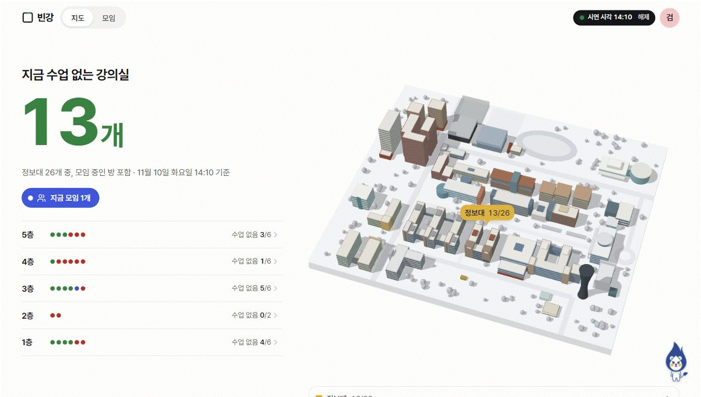
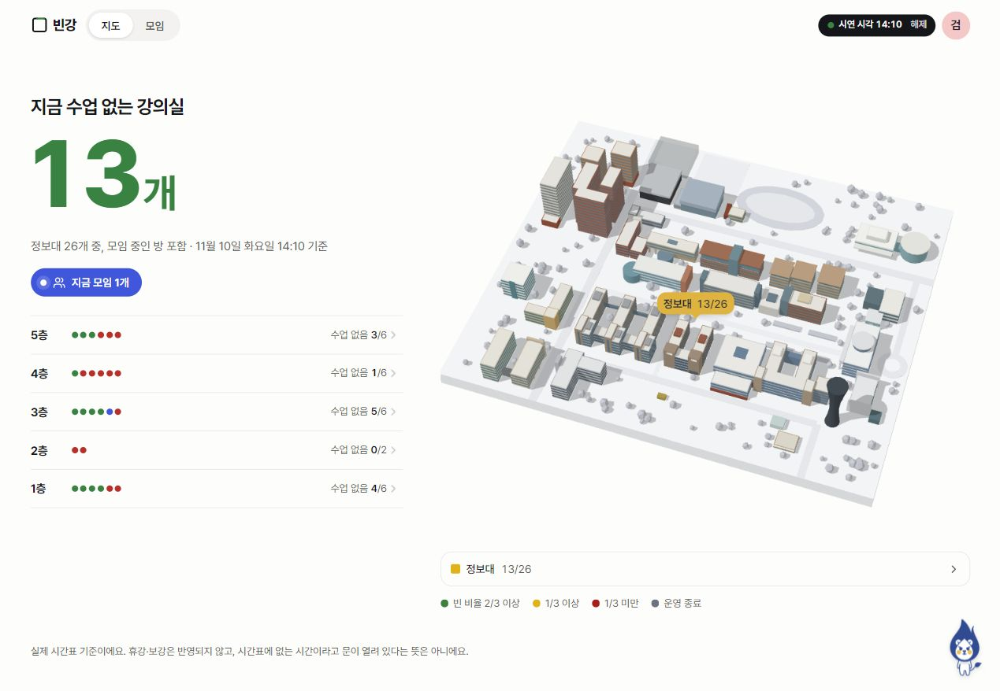
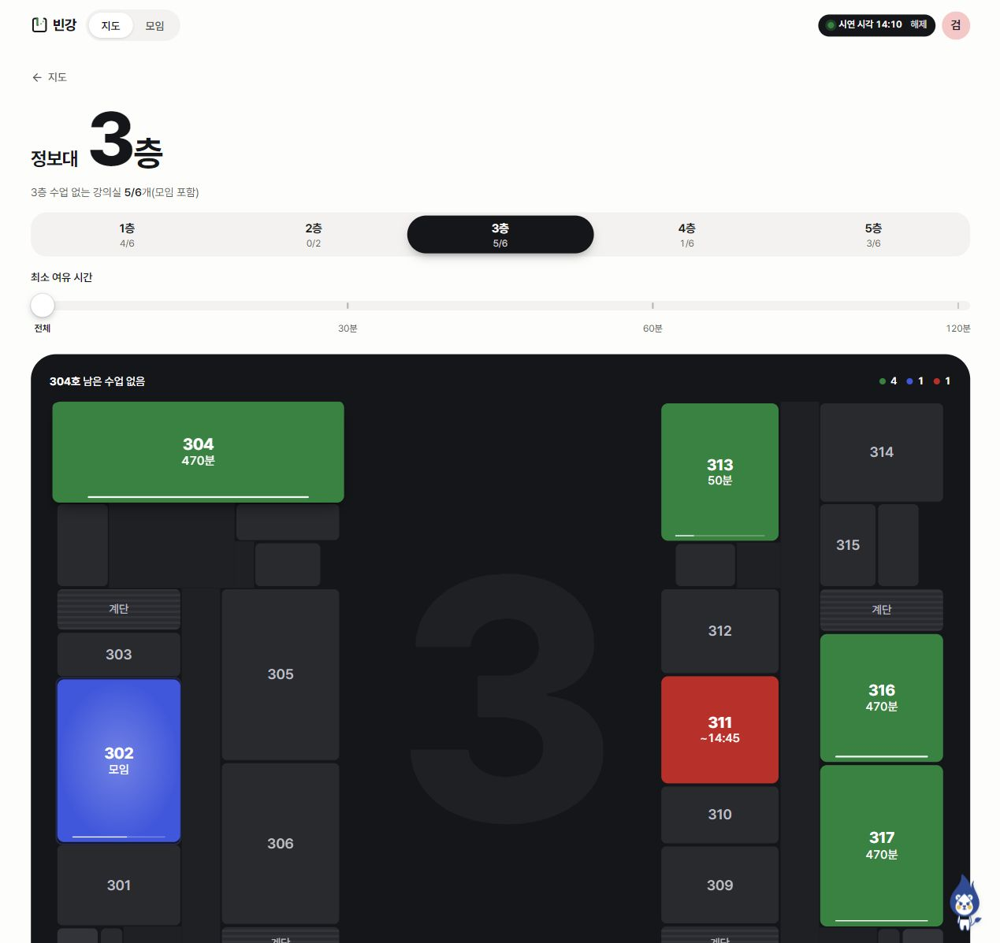
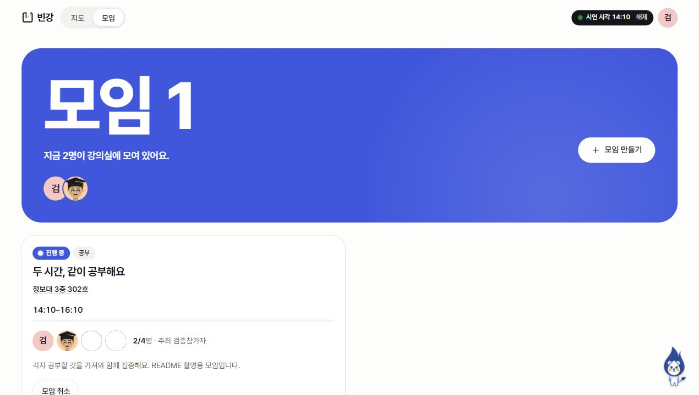
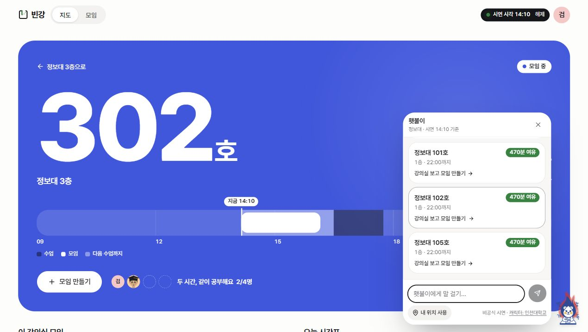
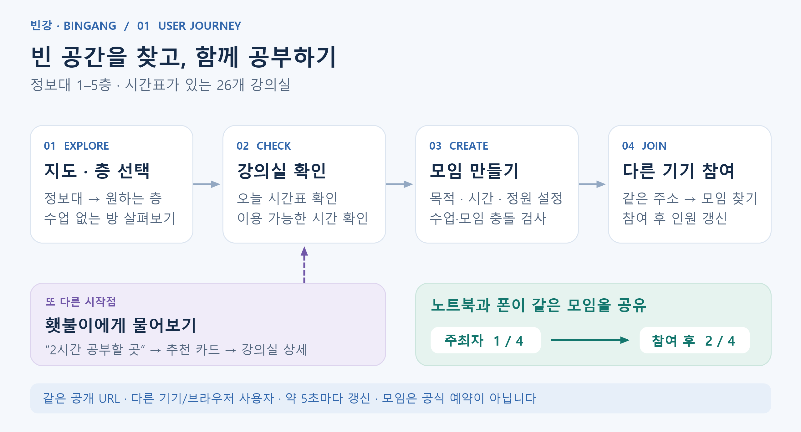
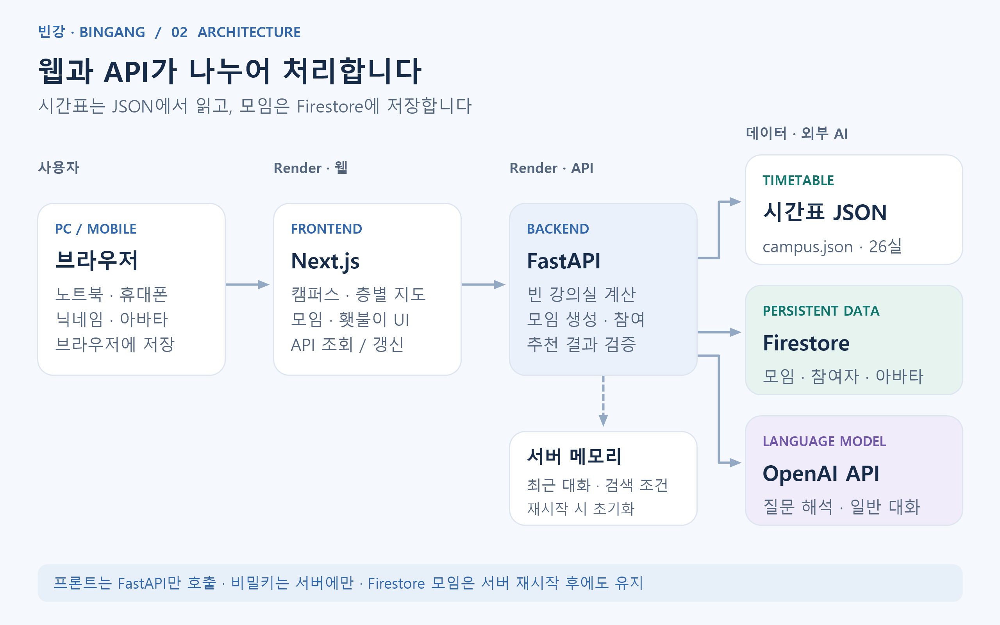

# 빈강 | 빈 강의실을, 함께할 공간으로

🏆 **인천대학교 인공지능대학(정보기술대학) 바이브코딩 대회 대상 (정보기술대학장상)**

**빈강**은 시간표로 빈 강의실을 찾고, 공부할 사람을 모으고, 횃불이에게 자연어로 장소를 추천받는 캠퍼스 웹 서비스입니다.

[서비스 바로가기](https://bingang-web.onrender.com/) · [시연 시작](https://bingang-web.onrender.com/?at=2026-11-10T14%3A10%3A00%2B09%3A00) · [실행·개발 가이드](docs/guide.md) · [API 문서](https://bingang-api.onrender.com/docs)

## 빈 공간을 발견하고, 함께 이용하기

도서관 스터디룸이 부족할 때, 다음 수업 전 잠깐 공부하고 싶을 때. 빈강은 시간표를 하나씩 뒤지는 대신 지도에서 공간을 찾고 모임으로 연결합니다.

현재는 **인천대학교 정보대(7호관) 1–5층, 시간표가 있는 강의실 26개**를 제공합니다.



*실제 화면 캡처를 이어 붙인 약 10초 GIF · 캠퍼스 → 층별 지도 → 모임 참여(1명 → 2명)·강의실 확인*

상태 색상과 남은 시간으로 공간을 비교하고, 시간 슬라이더로 모임 시간을 고릅니다. 횃불이는 필요할 때만 여는 작은 대화창으로 배치했습니다.

촬영: 2026-11-07 · 조회 기준: **2026-11-10(화) 14:10 KST**. 공부 모임은 실제 생성·참여 후 촬영을 마치고 취소했습니다.

<details>
<summary>화면별 자세히 보기</summary>

**캠퍼스 지도** — 정보대를 선택해 층별 강의실로 이동합니다.



**층별 보기** — 수업 중(빨강)·수업 없음(초록)·모임 중(파랑)을 한눈에 확인합니다.



**모임** — 같은 공개 주소로 접속한 다른 사용자와 모임을 공유합니다.



**횃불이** — 오른쪽 아래 마스코트를 누르면 작은 대화창이 열립니다. 아래는 촬영 당시 AI 연결 실패로 제공된 규칙 기반 추천 화면입니다.



</details>

## 핵심 기능과 사용 흐름

| 기능 | 할 수 있는 일 |
| --- | --- |
| 강의실 찾기 | 건물·층·최소 이용 시간으로 조회하고 오늘 시간표 확인 |
| 캠퍼스 시각화 | 3D 캠퍼스 → 층별 도면 → 강의실 상세로 이동 |
| 모임 만들기·참여 | 목적·시간·정원 설정, 다른 기기에서 참여·나가기, 주최자 취소 |
| 횃불이 AI | “7호관에서 2시간 공부할 곳” 추천, 후속 질문과 일상 대화 |
| 위치·프로필 | 선택적 GPS 거리 안내, 직접 말한 현재 층 반영, 닉네임·아바타 |



모임 생성 시 수업·다른 모임과의 시간 충돌을 검사합니다. 다른 사용자의 변경은 활성 화면에서 **약 5초마다 재조회**해 반영합니다.

## 어떻게 작동하나요?



| 구분 | 기술·역할 |
| --- | --- |
| 웹 | Next.js · TypeScript · Tailwind CSS · shadcn/ui |
| API | FastAPI · Python, 시간표 계산과 모임 API |
| 데이터 | 시간표 JSON 스냅샷 + Firebase Firestore 모임 저장 |
| AI | OpenAI API로 질문 해석·일반 대화, 서버 계산으로 추천 검증 |
| 배포 | Render의 `bingang-web` · `bingang-api` |

프론트는 FastAPI만 호출합니다. AI가 해석한 조건으로 서버가 수업과 모임을 검사해 **최대 3개 강의실**을 추천합니다. GPS 좌표는 서버 거리 계산에만 사용합니다. [AI 추천 흐름도](docs/diagrams/ai-flow.png) · [데이터·위치 처리 상세](docs/guide.md#횃불이-ai가-답하는-과정)

## AI와 함께 만든 과정

Claude Code·Codex로 구현하고 ChatGPT Pro로 설계를 구체화·검토했습니다.

1. **구조화한 SPEC** — 입력 → 결과 → 완료 기준으로 기능과 역할·일정을 정리했습니다.
2. **공통 AGENTS.md와 API 계약** — 담당 폴더, 데이터 형식, 오류 규칙을 공유해 병렬 작업을 연결했습니다.
3. **실패를 재현하는 피드백** — 실제 질문·모임 충돌·참여 사례를 다시 입력하고 수정·검증 기록을 남겼습니다.

[설계 프롬프트](docs/prompts/spec-v0-prompt.md) · [Pro 구체화 요청](docs/prompts/pro-spec-v1.md) · [공통 AI 규칙](AGENTS.md) · [전체 프롬프트 기록](docs/prompts/) · [검증 결과와 알려진 문제](docs/guide.md#검증-상태와-현재-한계)

## 팀

| 팀원 | 주요 담당 | 작업 기록 |
| --- | --- | --- |
| 정성민 · 프론트 | 캠퍼스·층별 화면, 모임 UI, 아바타, 디자인·통합 | [fe](docs/log/fe.md) |
| 설창원 · 백엔드 A | 모임 API, Firestore, 배포, 후속 횃불이 기능 통합 | [be-a](docs/log/be-a.md) |
| 김강산 · 백엔드 B | 시간표 가공·조회, 가용 시간 핵심 로직 | [be-b](docs/log/be-b.md) |

## 직접 써보거나 실행하려면

- **설치 없이:** [시연 링크](https://bingang-web.onrender.com/?at=2026-11-10T14%3A10%3A00%2B09%3A00)를 열면 2026-11-10(화) 14:10 KST 기준입니다. 무료 서버 첫 접속은 지연될 수 있습니다.
- **두 사용자 시연:** 다른 기기나 독립된 브라우저에서 각자 닉네임을 정하고, 한쪽에서 모임을 만든 뒤 다른 쪽에서 참여합니다. [단계별 시연](docs/guide.md#직접-시연하기)
- **로컬 개발:** Git · Python 3.12 · Node.js 22를 준비하고 [키 없이 실행하기](docs/guide.md#로컬에서-실행하기)를 따릅니다. [환경변수·배포](docs/guide.md#환경변수와-배포)

```powershell
git clone https://github.com/seolcw/bingang.git
cd bingang
```

## 범위와 참고 자료

모임은 **강의실 사용 승인이나 독점 예약이 아닙니다.** 시간표상 수업이 없다는 뜻이며, 홈 집계에는 모임 중인 방도 포함됩니다. 실제 점유·휴강·출입 상태를 실시간으로 확인하지 않습니다.

로그인 인증, 모임원 간 채팅, 푸시 알림은 아직 없습니다. 모임 참여는 서버의 실제 현재 시각을 사용하므로 시연 날짜가 지난 뒤에는 미래 시간대를 선택해야 합니다. [전체 제한 사항](docs/guide.md#아직-지원하지-않는-것과-구분할-점)

[초기 SPEC](docs/SPEC.md) · [정보대 범위 변경](docs/scope-change.md) · [API 계약](contracts/api.md) · [백엔드 안내](backend/README.md) · [출처·라이선스 안내](docs/guide.md#관련-문서와-출처)

시간표는 팀이 가공한 스냅샷을 사용합니다. 횃불이는 인천대학교의 캐릭터이며, 빈강은 학교 공식 서비스가 아닌 대회 출품작입니다. 발표 PDF·원본 엑셀·비밀키는 저장소에 포함하지 않습니다.
