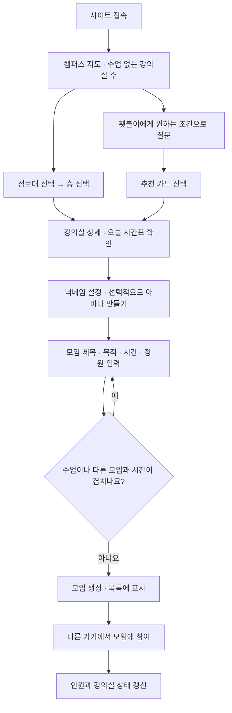
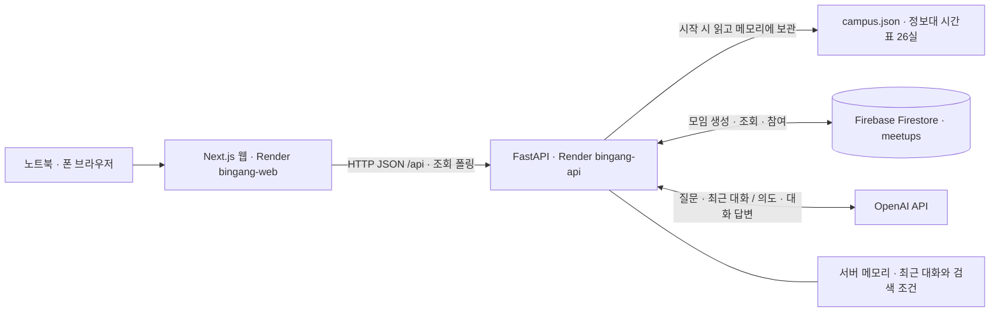
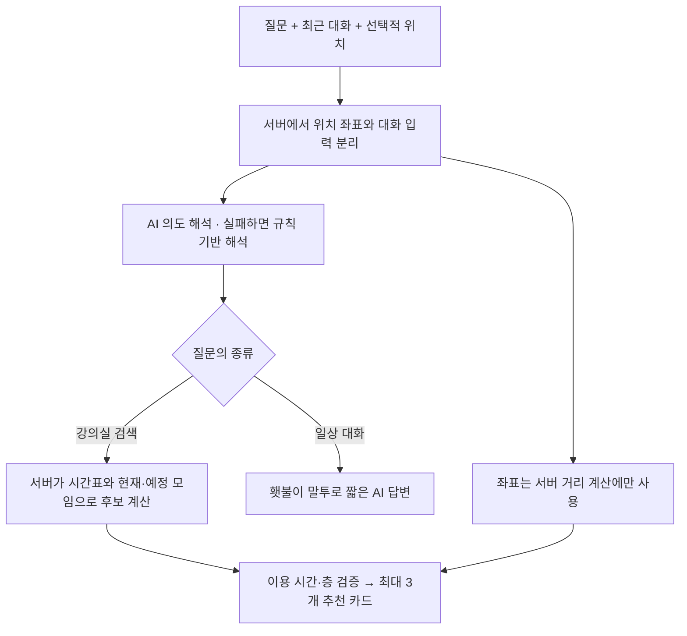

# README 다이어그램

루트 [README](../../README.md)는 별도 Mermaid 실행 없이 보이는 PNG 이미지를 사용합니다. 각 이미지는 가로 2,560px이며, 큰 이미지는 클릭해서 확인할 수 있습니다.

## 이미지

- [사용 흐름](user-flow.png)
- [시스템 구성](architecture.png)
- [AI 추천 과정](ai-flow.png)

## 다시 만들기

Windows의 기본 System.Drawing과 맑은 고딕을 사용합니다. 추가 패키지는 필요하지 않습니다. 저장소 루트의 PowerShell에서 실행합니다.

```powershell
.\docs\diagrams\render-diagrams.ps1
```

글자·색상·배치는 [렌더링 스크립트](render-diagrams.ps1)에서 수정합니다. PNG와 스크립트를 함께 커밋합니다. 서비스 코드나 배포 설정에는 영향을 주지 않습니다.

## 원래 흐름도 소스

아래 Mermaid는 이미지의 바탕이 된 기존 상세 흐름입니다. PNG는 처음 보는 사람을 위해 이를 단순화한 그림이며 자동 Mermaid 렌더링 결과는 아닙니다.

### 사용 흐름



### 시스템 구성



### AI 추천 과정


